# PUSULA — Smart Education Assistant

PUSULA is a web-based smart education assistant developed as a Software Engineering double-major graduation project. It provides student and teacher views, course workflows, quizzes, notifications, learning progress, and an AI tutor integration.

## Tech stack
- **Frontend:** React 18, TypeScript, Vite, Tailwind CSS, shadcn/ui
- **Backend & data:** Supabase client, authentication and database migrations
- **Serverless functions:** Supabase Edge Functions (`ai-tutor`, `send-motivation-emails`)
- **Libraries:** React Router, TanStack Query, React Hook Form, Zod, Recharts

## Project structure
- `src/pages/student` — student dashboard, course details, course join, chat
- `src/pages/teacher` — teacher dashboard and course details
- `src/components` — reusable UI, notifications, layout
- `src/integrations/supabase` — Supabase client and generated types
- `supabase/functions` — AI tutor and email functions
- `supabase/migrations` — database schema migrations

## Local setup
1. Install Node.js and npm.
2. Run `npm install`.
3. Copy `.env.example` to `.env` and supply **your own** Supabase project values.
4. Run `npm run dev`.
5. Open the local address printed by Vite.

```bash
npm install
npm run dev
```

The UI may require a compatible configured Supabase backend for sign-in, course data, quiz features and AI-related functionality. This repository does **not** include production credentials or deployed backend services.

## Validation
```bash
npm run build
npm run lint
npm test
```

The repository was reviewed for structure but has **not** been built or integration-tested as part of this portfolio packaging. Feature behavior in a fresh environment must be verified after configuring Supabase.

## Notes
This archive intentionally excludes `node_modules`, `dist`, temporary Supabase files and `.env`. Before public release, review any project-specific API credentials, authorization policies, external integrations and demo/test accounts. Do not commit Supabase service-role keys or other secrets.

## Application Screenshots

The screenshots below are taken from the PUSULA Smart Education Assistant graduation project report (2026). They document application interfaces and example workflows; availability of an online deployment is not implied.

### Registration
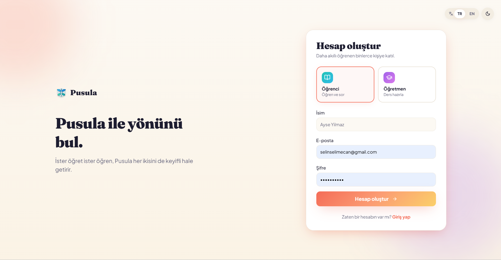

### Student dashboard
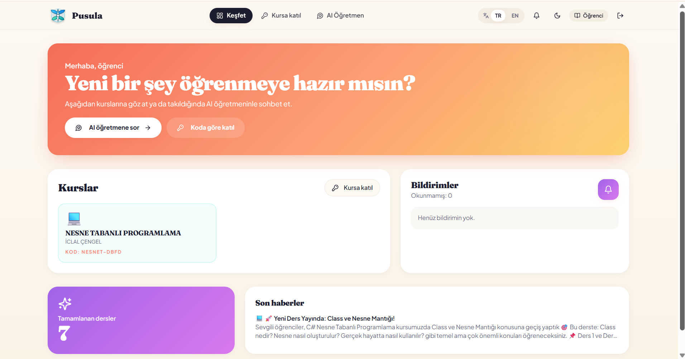

### Teacher dashboard
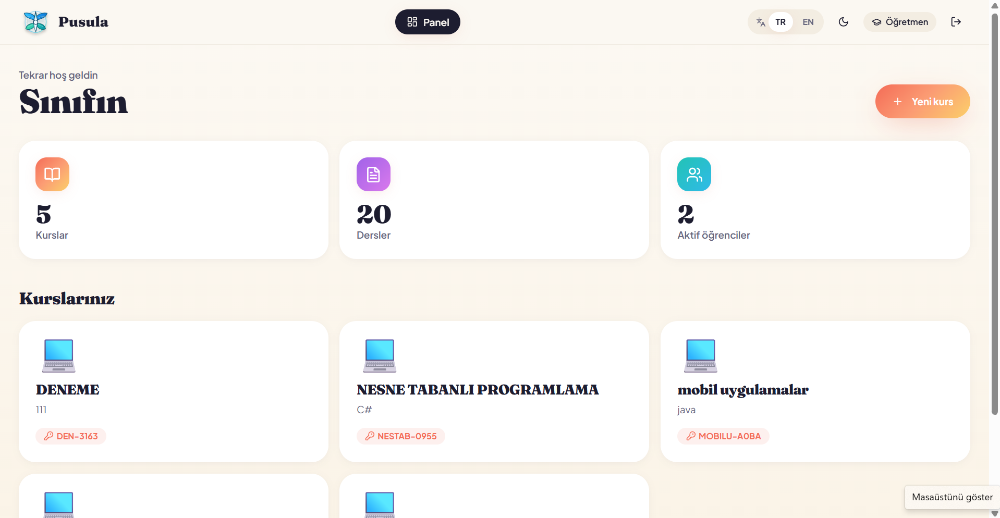

### AI-assisted tutoring
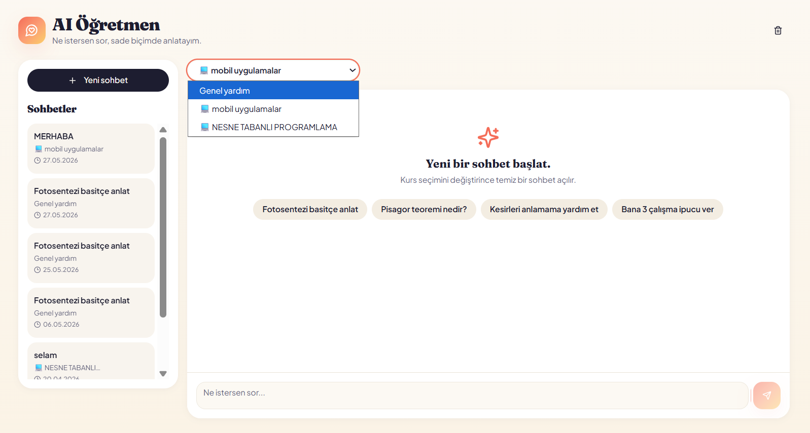
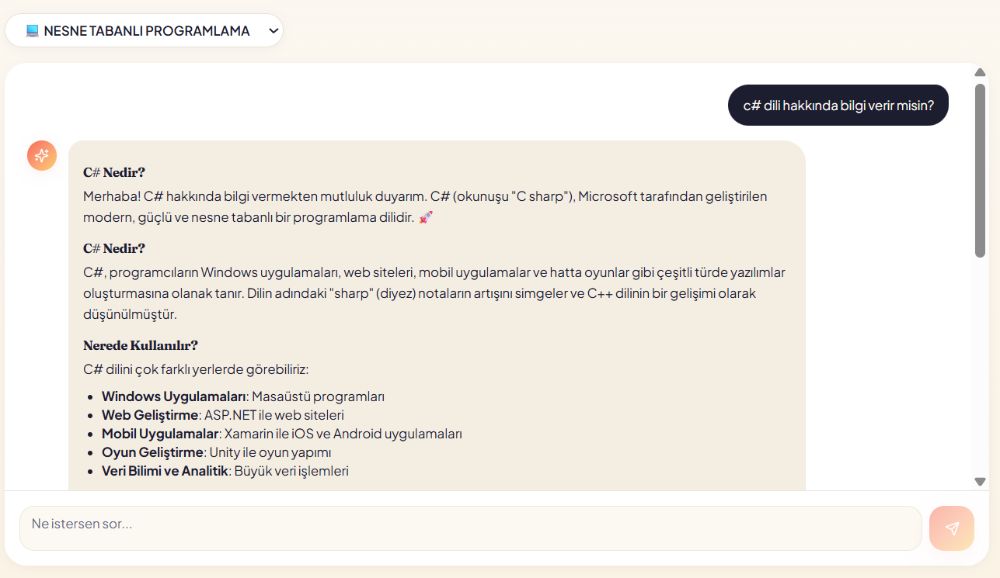

### Course management
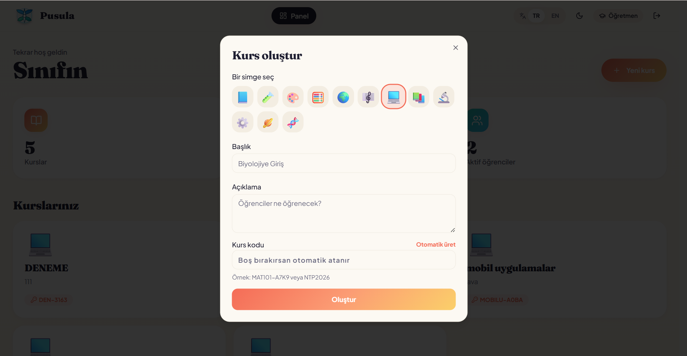
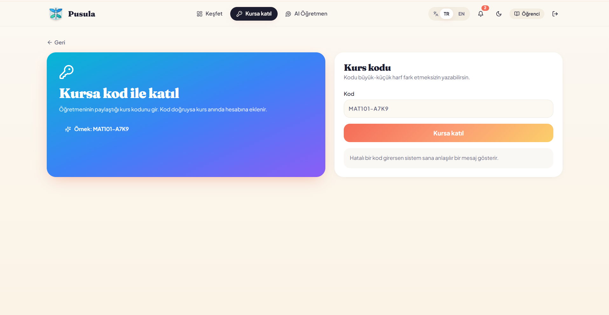
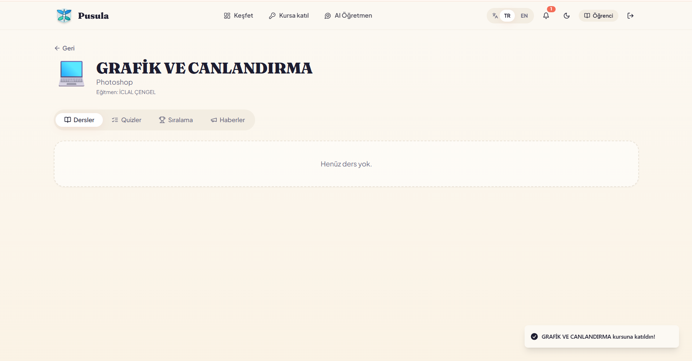

### Quizzes
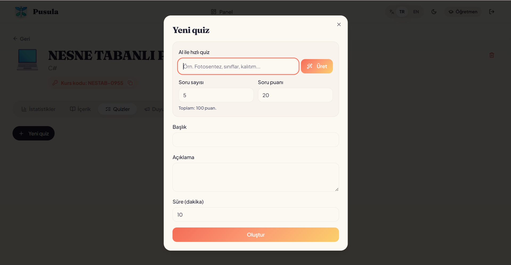
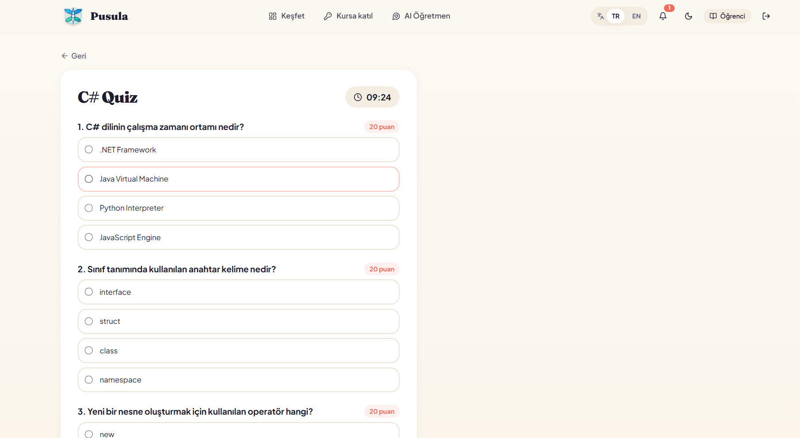
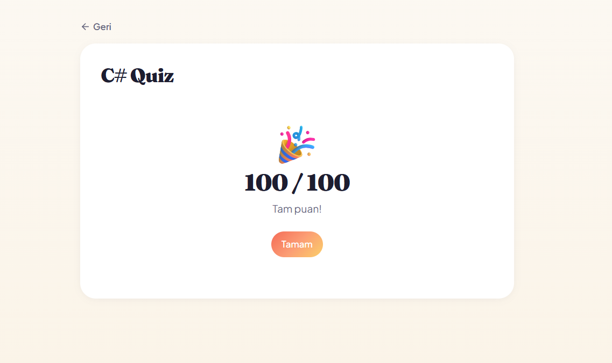

### Notifications
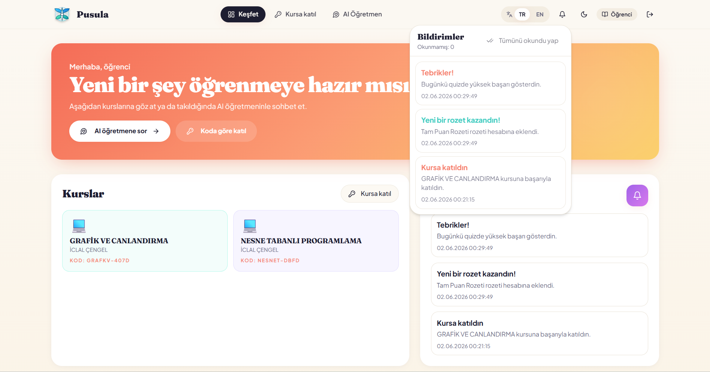


## Developer
**İclal Çengel** — Computer Engineering & Software Engineering

GitHub: https://github.com/iclalcengel
